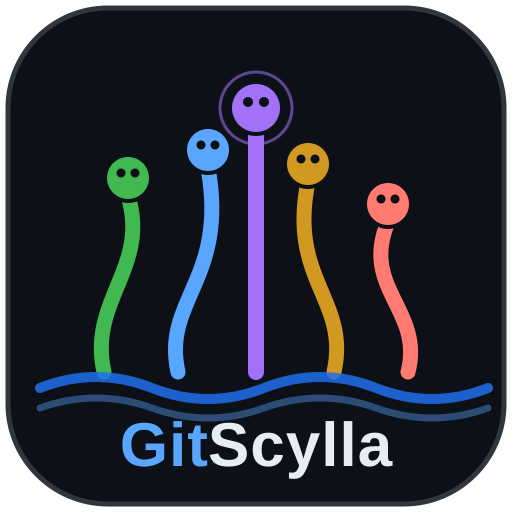
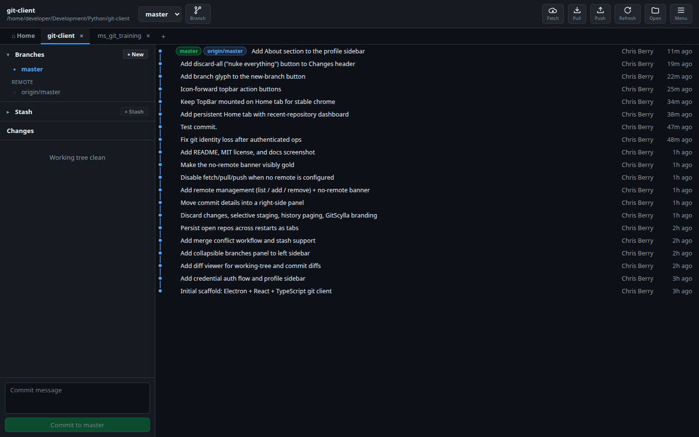

<p align="center">
  
</p>

<h1 align="center">GitScylla</h1>

<p align="center">
  <em>A git client with teeth.</em>
</p>

<p align="center">
  
  
  
</p>

GitScylla is a desktop Git client for people who'd rather click than type.
It wraps your system `git` in a modern UI — repository tabs, a lane-colored
commit graph, line-level diffs, conflict resolution, stashing, and
credential-managed push/pull — without hiding what's actually happening
underneath.



## Features

- **Repository tabs** — open several repos at once; they persist across
  restarts and a stale dot marks background tabs that changed on disk
- **Commit graph** — topo-ordered lane layout matching `git log --graph`
  conventions, paged 300 commits at a time
- **Full working-tree control** — stage, unstage, selectively multi-stage
  via checkboxes, discard changes, delete untracked files (with a confirm
  dialog — it is permanent)
- **Line-level diffs** — unstaged, staged, untracked (synthesized add-diff),
  binary detection, per-file commit diffs, and stash diffs
- **Branches** — local + remote listing, checkout, create, merge-into-current
- **Merge conflicts** — detects merge/rebase/cherry-pick in progress, banner
  with abort, ours/theirs resolution, highlighted conflict markers in diffs
- **Stash** — push (with optional message), list, view diff, apply, pop, drop
- **Remotes** — add/list/remove remotes; a banner nags you to add one when
  a repo can't be pushed
- **Auth** — GitHub personal access tokens stored encrypted via the OS
  keychain (`safeStorage`), supplied to git through `GIT_ASKPASS`; failed
  pushes offer to save credentials and retry
- **History for days** — load more commits on demand, live file watching so
  the UI follows CLI activity too

## How it works

```
┌─────────────────────────────────────────────┐
│  Renderer (React 19 + zustand)              │
│  Tabs · graph · diffs · panes               │
└──────────────┬──────────────────────────────┘
               │ typed IPC (contextBridge)
┌──────────────▼──────────────────────────────┐
│  Main process (Electron)                    │
│  Map<repoPath, GitService> — one service    │
│  + one recursive fs.watch per open repo     │
│  simple-git → your system git binary        │
│  credentials.json (encrypted) + session.json│
└─────────────────────────────────────────────┘
```

- **Git operations** run in the Electron main process through
  [`simple-git`](https://github.com/steveukx/git-js), never in the renderer.
- **Authentication** — for HTTPS remotes, git asks for credentials; the app
  answers via a generated `GIT_ASKPASS` script fed from the encrypted
  credential store. Nothing is stored in plain text and nothing goes through
  the repo.
- **File watching** is a hand-rolled per-directory `fs.watch` tree
  (Node's `{recursive: true}` crashes on Linux), debounced per repo.
- **Session** — open tabs and the active tab persist to
  `~/.config/git-client/session.json`.

## Requirements

- Linux (x86_64) — Windows/macOS builds are possible but untested
- `git` installed and on `PATH`
- Node.js 20+ (for development/build only — the AppImage is standalone)

## Getting started (development)

```bash
npm install
npm run dev
```

> If your environment exports `ELECTRON_RUN_AS_NODE`, prefix dev commands
> with `env -u ELECTRON_RUN_AS_NODE`.

### Other scripts

| Command | Does |
| --- | --- |
| `npm run typecheck` | Type-checks main, preload, and renderer |
| `npm run build` | Typecheck + production bundle to `out/` |
| `npm run build:linux` | Produces `dist/gitscylla-*.AppImage` and `dist/gitscylla_*.deb` |
| `npm run build:unpack` | Unpackaged `dist/linux-unpacked` dir for quick testing |

## Install (prebuilt)

```bash
# AppImage — no install, just run
./gitscylla-1.0.0.AppImage          # may need: sudo apt install libfuse2

# Debian/Ubuntu/Mint/Pop!_OS
sudo dpkg -i gitscylla_1.0.0_amd64.deb
```

## GitHub authentication

Git over HTTPS can't prompt for a password (GitHub disabled password auth
in 2021). In the app: **☰ → GitHub credentials**, enter your username and a
[personal access token](https://github.com/settings/tokens):

- **Classic** — `repo` scope, covers everything
- **Fine-grained** — pick the repos, grant **Contents: Read and write**

The token is encrypted in `~/.config/git-client/credentials.json` and used
only to answer git's credential prompts.

## License

[MIT](LICENSE)

